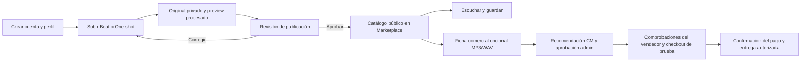

# Auditoría funcional y de dirección de BeatVault

Actualización 2026-10-27: los hallazgos de esta auditoría son una instantánea previa
a la consolidación. La resolución local de A1, continuidad, favoritos, One-shots y
carga de medios está registrada en [CONSOLIDATION_STAGES.md](CONSOLIDATION_STAGES.md).

Fecha: 2026-10-26. Entorno: Windows 11, PostgreSQL 16.15 local. Alcance:
recorridos de creador, visitante, comprador y moderación; correspondencia entre
interfaz, persistencia, permisos y documentación. La evaluación no certifica
seguridad absoluta, demanda comercial ni preparación para producción.

## Dictamen

BeatVault tiene un núcleo útil: un creador conserva su audio original privado,
publica un catálogo revisado y permite que otras personas descubran sus previews.
Marketplace organiza descubrimiento, favoritos y compras. La comunidad puede
ayudar a encontrar creadores y conversar sobre su trabajo.

La siguiente etapa debe cerrar las conexiones entre esas funciones. La cantidad
de pantallas y pruebas no demuestra que cada recorrido esté completo. En particular,
publicar un audio y autorizar su venta son dos procesos diferentes, y la interfaz
necesita explicarlos como tales.

## Recorrido que debe guiar el producto

El recorrido de publicación ya funciona localmente. El recorrido comercial tiene
código y pruebas con proveedor simulado, pero no equivale a una compra reconciliada
con Stripe real. Stems, suscripciones, distribución y expansión social siguen aplazados.

## Matriz funcional

| Área | Qué funciona | Qué falta para un recorrido claro |
| --- | --- | --- |
| Cuenta | Registro, login, sesiones persistidas, roles y cambios de contraseña | Recuperación por correo y verificación fuera del entorno de desarrollo |
| Subida y Mis subidas | Audio y artwork, preview procesado, recarga, reintentos, edición, archivo y estados de revisión | Explicar la diferencia entre revisión editorial y ficha comercial; equiparar la escucha de One-shots en moderación |
| Publicación de Beats | CM o admin pueden revisar y publicar; preview privado y rechazo con motivo | Mantener esta verificación al cambiar formatos/estados |
| Marketplace | Descubrimiento público, filtros, paginación, detalle real y previews | Conservar intención tras iniciar sesión y conectar mejor los proyectos del perfil con el detalle público |
| Mi biblioteca | Favoritos separados por cuenta y compras confirmadas | Los favoritos aún viven en el navegador, no en PostgreSQL |
| Compras | Snapshot de fuente/licencia, formatos MP3/WAV, comprobación de identidad, pago e integridad y retención de originales | Estado de aprobación comercial duradero y reconciliación real de proveedor antes de habilitar ventas |
| Perfil y ajustes | Identidad persistida, imágenes, privacidad y preferencias locales | Protección de cambios sin guardar al navegar; coherencia de textos y entradas al catálogo |
| Home e historias | Publicaciones con audiencia, interacciones e historias con caducidad | Destinos de notificaciones fuera de la página cargada; moderación de historias |
| Amigos y mensajes | Descubrimiento opt-in, solicitudes, chat entre amigos aceptados y SSE | Bloqueo/reporte y recuperación operativa antes de ampliar colaboración |
| Planes | Consulta del plan y cuotas locales; precios marcados como propuesta | Política comercial única. Las suscripciones no están implementadas |
| Operación local | PostgreSQL real, migraciones, copia/restauración verificadas y medios privados | Respaldo fuera del disco y procedimiento de recuperación para uso alojado |

## Hallazgos y prioridad

### A1 — Alta: las decisiones comerciales dependen del historial retenido

Confirmado por inspección del código. `latestMarketplaceReview` y
`sellerListingWithAdminReview` en `server/index.ts` consultan `audit.entries`.
La decisión administrativa se registra mediante `audit.recordAndWait`, sin una
transición equivalente guardada como estado vigente de la oferta.
`PostgresAuditStore.list` en `server/audit-store.ts` solo recupera eventos dentro de
la retención y del límite de registros. Los valores predeterminados en
`server/config.ts` son 365 días y 10 000 entradas.

Consecuencia: después de superar esos límites y reiniciar/recargar la auditoría,
una oferta puede quedarse sin aprobación vigente aunque no haya sido editada.
El bloqueo de venta es conservador, pero el estado comercial no es estable.
No se ha ejecutado en esta auditoría una simulación de 365 días/10 000 eventos.

Cierre requerido: guardar decisiones, versión revisada y revisión de evidencia en
persistencia de negocio; escribir transición y auditoría de forma transaccional.
Probar aprobación → rotación del historial → reinicio → misma elegibilidad, e
invalidación tras editar ficha/evidencia. Resolver antes de habilitar ventas.

### A2 — Alta, corregido: Ajustes describía mal la privacidad

La sección Privacidad afirmaba que las publicaciones se guardaban solo en el
dispositivo y no se mostraban a otros usuarios. Eso contradice Home y sus audiencias.
Se corrigió el texto de `src/components/CreatorProfile.tsx`: publicaciones e historias
se guardan en el servidor local, y su visibilidad depende de audiencia y perfil.
También se aclaró que los ajustes de notificaciones filtran esta interfaz y se guardan
en el dispositivo; no activan email ni avisos del sistema.

### A3 — Media: iniciar sesión pierde el contexto de descubrimiento

Confirmado por inspección. Los enlaces públicos llevan a `#/login`, y el login de
`src/app/App.tsx` vuelve a Marketplace sin conservar detalle, búsqueda u oferta previa.
Un visitante que encuentra un Beat debe localizarlo otra vez después de entrar.

Cierre requerido: conservar un destino interno validado y devolver al usuario al
audio o pestaña que abrió. Probar entrada desde detalle, tienda y biblioteca, y
rechazo de destinos externos. No reintentar pagos automáticamente al iniciar sesión.

### A4 — Media: el perfil público no conecta todos sus proyectos con la escucha

Confirmado por inspección. Los proyectos públicos de `CreatorProfile.tsx` abren un
diálogo de metadata. La escucha/gestión de ese diálogo está limitada a `showPrivate`;
no ofrece un enlace al detalle público para un proyecto publicado sin oferta.
La pestaña comercial cubre solo Beats con ofertas. Un visitante puede ver un proyecto
y no encontrar el siguiente paso hacia su preview, aunque Marketplace tenga ese detalle.

Cierre requerido: enlazar cada proyecto publicado a su detalle público verificado,
manteniendo originales y borradores privados. Probar visitante, usuario ajeno y dueño.

### A5 — Media: favoritos y preferencias todavía dependen del navegador

`src/data/localFavorites.ts` y `src/data/userSettings.ts` usan almacenamiento local
separado por cuenta. PostgreSQL conserva compras e identidad, pero no esos favoritos.
Una sesión en otro navegador o la limpieza de sus datos no recupera la colección.
Es una limitación funcional conocida, no una pérdida de los originales del servidor.

Cierre requerido: decidir favoritos como datos de cuenta y persistirlos con permisos;
migrar los existentes sin atribuir claves antiguas sin dueño. Hasta entonces, explicar
claramente qué se conserva solo en este navegador.

### A6 — Media: hay navegación y edición que no cierran el recorrido

La advertencia de edición del perfil cubre cierre de página y Cancelar, pero los
enlaces internos pueden desmontar el editor sin conservar el borrador.
La prueba nueva de primer uso adjunta una observación de este comportamiento.

Las notificaciones de publicaciones usan `#/home?post=...`. Home intenta desplazar
al elemento ya cargado, sin recuperar por ID una publicación anterior a las páginas
visibles. El efecto depende de la colección de posts y no del cambio de destino.
Esto se confirmó por inspección, sin reproducir todavía un historial largo completo.

Cierre requerido: confirmar salida o recuperar borrador; resolver un enlace de
notificación con autorización y mostrar un estado claro si el destino fue retirado.

### A7 — Media: One-shots no tienen la misma experiencia de moderación

La cola del CM y su preview privado están filtrados a Beats en `server/index.ts`.
Admin sí recibe One-shots pendientes, pero `previewAvailable` y el reproductor de la
cola administrativa se calculan/muestran solo para Beats (`Admin.tsx`). Por tanto,
no hay escucha equivalente dentro de esa cola antes de decidir sobre un One-shot.
Es una diferencia del flujo confirmado por inspección; no demuestra por sí sola
un fallo de almacenamiento o reproducción pública del formato.

Cierre requerido: probar subida One-shot → preview privado del revisor → rechazo
y corrección → publicación → preview público, con una política de roles explícita.

### A8 — Condición previa a comercio: propuestas y reglas efectivas distintas

`src/domains/plans.ts` propone comisiones 12/8/5 % y precios de membresía.
El checkout usa una comisión de configuración del servidor, sin derivarla del plan.
Los precios están etiquetados como propuesta y el cobro de membresías está deshabilitado;
no se confirmó un cargo incorrecto real.

Cierre requerido: una política aprobada y compartida por UI/backend; reflejar cuotas,
comisión y habilitación efectivas. No activar suscripciones a partir de esta maqueta.
Las promociones administrativas tampoco deben prometer descuentos hasta aplicarse
de forma consistente en catálogo, checkout y snapshot de compra.

### A9 — Media, corregido parcialmente: el mapa de construcción estaba atrasado

`src/app/modules.ts` seguía proponiendo implementar imágenes personalizadas,
persistencia PostgreSQL de chat y revisión del catálogo ya verificadas. Se actualizaron
los siguientes pasos para no orientar diagnósticos hacia tareas resueltas.
Se actualizó el alcance activo para separar publicación, comercio y trabajo alojado.
Los documentos históricos se conservan como tales.

### A10 — Antes de comercio: el checkout del perfil no conserva las mismas protecciones

Confirmado por inspección. `Marketplace.tsx` valida el origen de la URL de checkout y
descarta respuestas de una sesión anterior. `buyOffer` en `CreatorProfile.tsx` redirige
directamente con la URL recibida y no comprueba si el usuario abandonó la pantalla o
cambió de cuenta mientras esperaba. No se reprodujo un cargo indebido ni una URL
maliciosa en esta auditoría.

Cierre requerido: compartir la operación de checkout con validación de destino,
idempotencia y cancelación lógica al cambiar sesión/pantalla. Probar respuesta lenta
tras logout y rechazo de una URL externa inesperada desde ambas superficies.

## Calidad de construcción

Puntos a conservar: repositorios separados para persistencia, contratos/validadores,
permisos del servidor, medios privados, snapshots de entrega y pruebas de integración.
La migración a PostgreSQL fue acompañada por comprobaciones de integridad y restauración.

Deuda concreta: `server/index.ts` concentra rutas y decisiones de varios dominios;
`CreatorProfile.tsx` agrupa perfil, ajustes, publicaciones y ofertas. La compra aparece
en Marketplace y perfil, lo que obliga a mantener las mismas reglas de respuesta tardía,
sesión y destino seguro en más de un sitio. Conviene extraer por dominio después de
fijar las pruebas de recorrido, sin una reescritura general de la app.

## Secuencia recomendada

1. **Claridad y continuidad:** corregir textos, retorno del login, enlace perfil/audio,
   borradores y destinos de notificaciones. Cierre: cada llamada a la acción llega a
   un resultado o a un estado de error con salida clara, en escritorio y móvil.
2. **Catálogo completo:** verificar Beats y One-shots con cuentas de creador/revisor
   independientes, incluyendo rechazo, edición, archivo y recuperación tras fallo.
3. **Datos de cuenta:** favoritos en PostgreSQL y explicación de preferencias locales.
   Cierre: otra sesión recupera la misma colección sin exponer la de otra cuenta.
4. **Comercio estable:** A1, A8 y A10, después checkout/webhooks/reembolsos con proveedor
   de prueba real. Cierre: compra confirmada y archivos correctos tras reinicio,
   cambios de oferta y reintentos, sin habilitar cobros por estados solo del navegador.
5. **Operación y comunidad:** recuperación fuera del disco, entrega de correo,
   bloqueo/reporte y moderación de historias antes de ampliar el acceso.

No incorporar stems ni nuevos módulos durante estos cierres. La prioridad de producto
es que un creador publique un audio y otra persona lo encuentre, escuche y entienda
qué puede hacer con él.

## Evidencia y límites

- La API del usuario respondió `storageBackend: postgres` al comenzar la auditoría.
- El registro previo `artifacts/postgres-change-unit.log` contiene 390 pruebas
  aprobadas en 73 archivos; no es una nueva ejecución completa en esta auditoría.
- Se añadió un modo de navegador con base PostgreSQL nueva y temporal, usuario de
  aplicación sin permisos administrativos y rechazo de URLs remotas/bases del usuario.
  La limpieza solo elimina la base creada por esa invocación.
- La ejecución completa inicial registró 29 casos aprobados y quedó interrumpida,
  sin resultado final. No se contabiliza como suite completa aprobada.
- Ejecución focalizada: 8/8 casos aprobados en 1,5 minutos. Incluye registro de primer
  uso, identidad recuperada en navegador nuevo, perfiles escritorio/móvil, privacidad
  de perfil de amigo, publicación con CM/admin, Marketplace integrado escritorio/móvil
  y Ajustes. Registro: `artifacts/product-audit-postgres-focused.log`.
- Prueba nueva: registro desde la interfaz → perfil persistido → login en navegador
  nuevo → misma identidad; perfil privado inicial y cobro de planes deshabilitado.
- Algunas pruebas de UI usan respuestas simuladas. Los recorridos reales seleccionados
  usan la API y PostgreSQL; no todos los tests de navegador constituyen una integración
  real ni prueban pagos con un proveedor externo.
- TypeScript, ESLint y la compilación de producción pasaron con los cambios de esta
  auditoría. El lanzador rechazó una URL de la base del usuario y una URL remota antes
  de iniciar la API de pruebas.
- Comprobación final de solo lectura: 9 cuentas, 88 proyectos y 8 registros de catálogo
  en `beatvault_local`; IDs, emails, roles y hashes de las cuentas originales coinciden
  con la fuente preservada. Registro: `artifacts/product-audit-owner-check.json`.
  No se cambiaron contraseñas ni se escribieron fixtures en la base del usuario.
